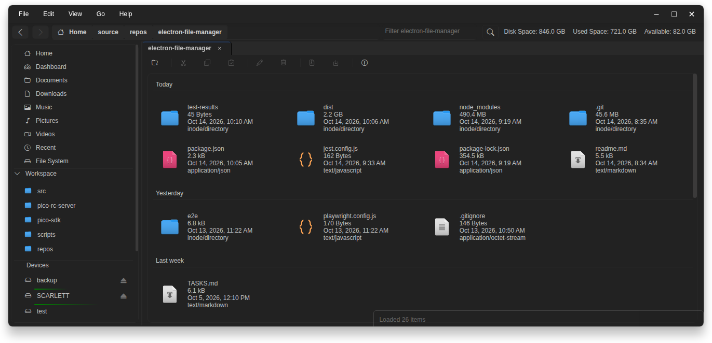
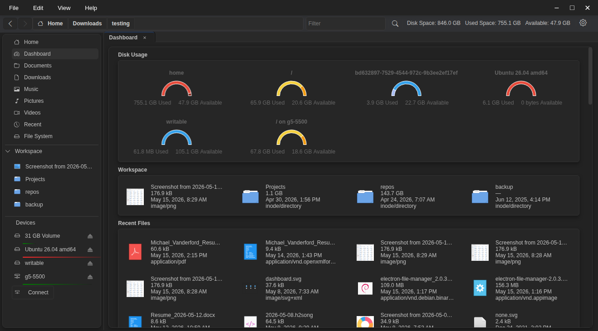
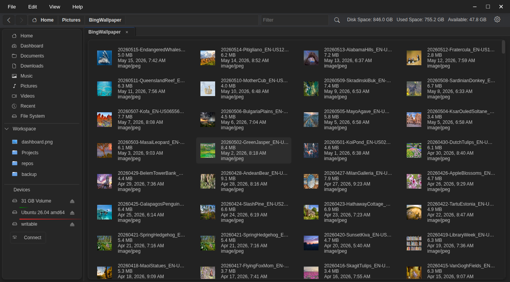
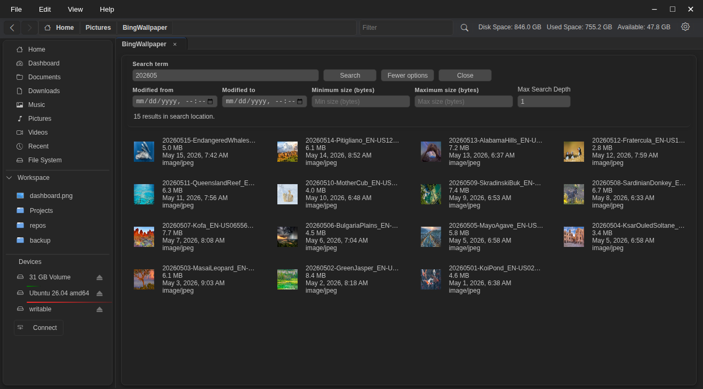
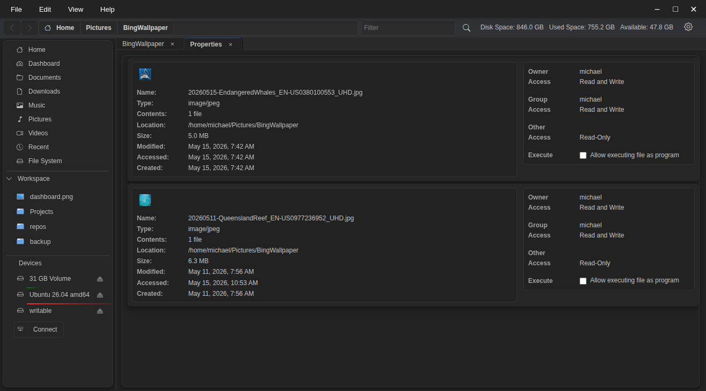
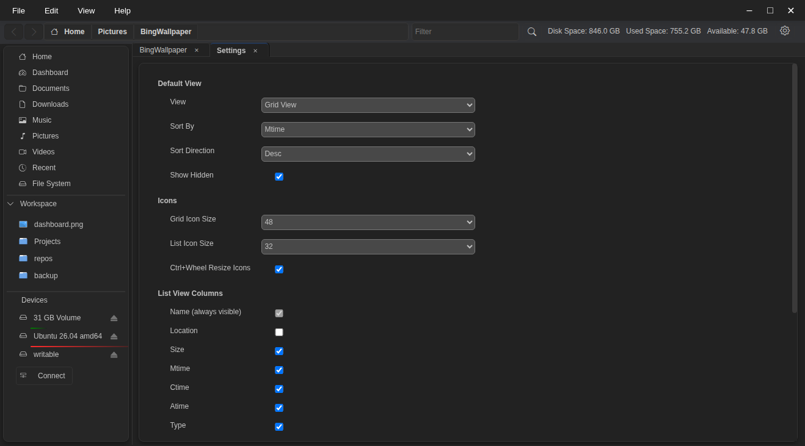
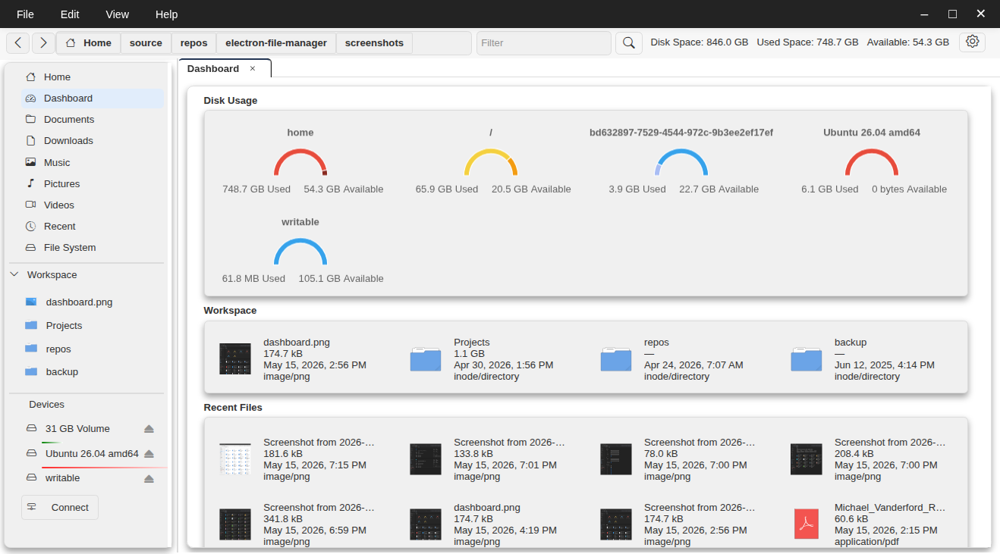

# Electron File Manager for Linux

> A fast, keyboard-friendly file manager for Linux, built with Electron.

---

<div align="left">
    
    <a href="screenshots">Screenshots</a>
    <!-- 
	
	
	
	
     -->
	<!--  -->
</div>

---

### Change log for 2026-10-29
- Improved search handling for large results
- Added custom themes and updated the app to version 2.1.0.
- Added file operation controls, tab content quick actions, and populated titlebar menus.
- Improved drag and drop with writable-directory checks and clearer visual feedback.
- Added file grouping and improved file watcher and recent-file handling.
- Improved device handling when remote connections fail.
- Added a dashboard with disk usage charts and workspace items; improved its layout and handling of missing recent-file data.
- Improved directory-size caching, operation progress, and sidebar behavior.
- Refactored filesystem and device handling around libfs and the libgio-node package.
- Updated Linux build settings, icons, screenshots, and installation documentation.
- Added Playwright end-to-end setup and tests for folder navigation, selection, tab state create/rename/delete, and copy/move.
- Updated dependency versions in package.json and package-lock.json.
- Added error handling for a missing Templates directory when building the menu.

## Features

### Navigation
- **Multi-tab browsing** with persistent tab history and back / forward navigation
- **Breadcrumb bar** with inline location input and path autocomplete
- **Sidebar** with quick links to Home, Documents, Downloads, Music, Pictures, Videos, Recent Files, and File System root
- **Recent files** view

### File Operations
- **Copy, cut, paste** files and folders
- **Drag-and-drop** to move or copy between locations (hold `Ctrl` to copy)
- **Rename** files and folders inline
- **Create** new folders
- **Delete** files and folders
- **Overwrite conflict resolution** — choose to replace or skip per file

### Views & Sorting
- **List view** and **Grid view**
- Configurable **columns** (name, size, modified, created, accessed, type, path, count)
- Resizable columns with persistent widths
- **Sort** by name, size, modified, created, or accessed — ascending or descending
- **Filter** files by name in the current view
- **Show / hide hidden files**

### Selection
- **Click**, **Ctrl+click**, and **Shift+click** selection
- **Drag-select** with a rubber-band rectangle
- **Auto-scroll** when dragging near the top or bottom edge of the view
- **Select all** (`Ctrl+A`)

### Compression & Archives
- **Compress** selected files to `tar.gz`, `tar.xz`, or `zip`
- **Extract** archives in place
- Progress indicator with cancel support

### Network & Devices
- **SSHFS** and **SSH** connections (public key authentication)
- **SMB / Windows Share** connections
- **Mount and unmount** drives and removable media
- **MTP** mobile device support (phones, tablets)
- **Disk usage indicator** per device in the sidebar
- **Connect to Network** button in the Devices panel

### Workspace Bookmarks
- **Pin folders** to the Workspace sidebar for quick access
- Rename, remove, and reorder bookmarks
- Folder icons displayed per bookmark

### File Properties
- Size, permissions, MIME type, timestamps, and more
- **Folder size** calculation in the background

### Icons & Thumbnails
- System-resolved file and folder icons via native GIO
- **Lazy-loaded icons** for large directories
- Resizable icons (`Ctrl+Wheel`)

### Settings
- View preference (list / grid)
- Default sort order and direction
- Startup location
- Disk utility application
- Show / hide hidden files
- Icon sizes (grid and list independently)

### Keyboard Shortcuts

| Action | Shortcut |
|---|---|
| New folder | `Ctrl+Shift+N` |
| Cut | `Ctrl+X` |
| Copy | `Ctrl+C` |
| Paste | `Ctrl+V` |
| Rename | `F2` |
| Delete | `Delete` |
| Select all | `Ctrl+A` |
| Open in new tab | `Ctrl+T` |
| Navigate back | `Alt+Left` |
| Navigate forward | `Alt+Right` |
| Go to location | `Ctrl+L` |

---

## Requirements

- Linux (x86-64)
- Node.js ≥ 18
- `sshfs` (optional, for SSHFS network mounts)
- `xz` for creating TAR.XZ archives; `gzip`, `xz`, and `bzip2` for standalone compressed streams
- Python ≥ 3.9 and the libarchive runtime library for ZIP, TAR, TAR.GZ, TAR.XZ, TAR.BZ2, and 7z extraction (`python3` on Linux; `python` on Windows)

Archive extraction validates each entry before writing. Paths escaping the output directory, links, special files, and duplicate file entries fail with an explicit error; partial output from reported failures or cancellation is removed. Regular file permissions (excluding special privilege bits) and modification times are retained. Archives containing links must be inspected/extracted with another tool. This is an intentional containment policy. Missing extraction prerequisites produce an error rather than using an unchecked fallback.

---

## Installation

```bash
git clone https://github.com/Michael-Vanderford/electron-file-manager.git
cd electron-file-manager
npm install
npm start
```

---

## Build

Produces a `.deb` package for Debian / Ubuntu:

```bash
npm run build
```

Output is written to the `dist/` directory.

## Deb Install

sudo dpkg -i dist/electron-file-manager_2.1.0_amd64.deb
---

## Tech Stack

| Component | Technology |
|---|---|
| Shell | Electron |
| Native FS / Icons | GIO (custom N-API addon) |
| Icons | Bootstrap Icons |
| Workers | Node.js Worker Threads |
| Tests | Jest |

---

## Contributing

Contributions, issues, and pull requests are welcome.
Please open an issue first to discuss significant changes.

---

## License

Licensed under **MIT.
See [LICENSE.md](LICENSE.md) for details.

---

## Author

**Michael Vanderford** — [michael.vanderford@gmail.com](mailto:michael.vanderford@gmail.com)
[https://github.com/michael-vanderford/sfm](https://github.com/michael-vanderford/sfm)
## Reliability and release checks

Preferences use atomic private-file replacement and last-good backups. Keep the profile's `.bak` and retained `.corrupt` files when investigating recovery problems. Linux password storage requires a secure Electron safeStorage backend; `basic_text` is not accepted. When secure storage is locked/unavailable, legacy plaintext configurations remain private and recoverable, automatic reconnect is disabled, and new password saves are refused with a message. A successful migration removes plaintext from the active and backup files.

JPEG/PNG previews use a small-image disk cache. GIF/WebP render directly through Chromium to preserve decoding and animation. The cache budget is soft for files served during the current app session; valid XCF and broader target-platform codec checks remain pending.

Run `npm run test:regression` for development checks. The opt-in packaged smoke gate is `EFM_PACKAGED_EXECUTABLE=/absolute/path/to/executable npx playwright test e2e/packaged.spec.js` (under Xvfb on headless Linux). See [release checks](docs/release-checks.md) and [feature verification](docs/features.md) for exact scope and remaining platform/service gaps.
